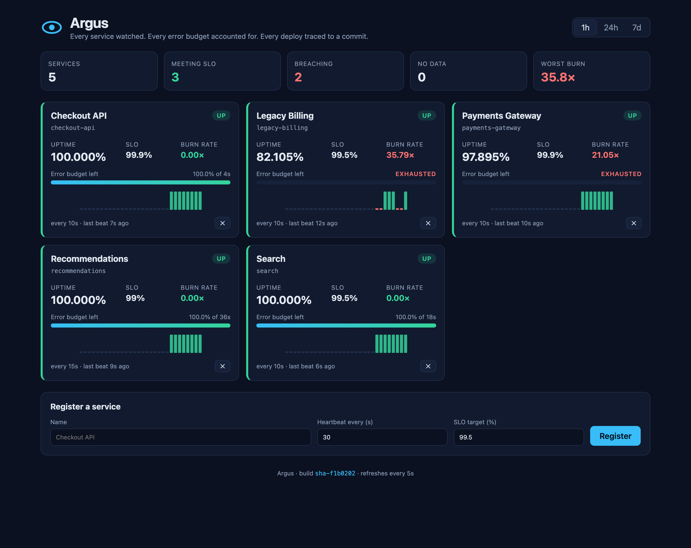
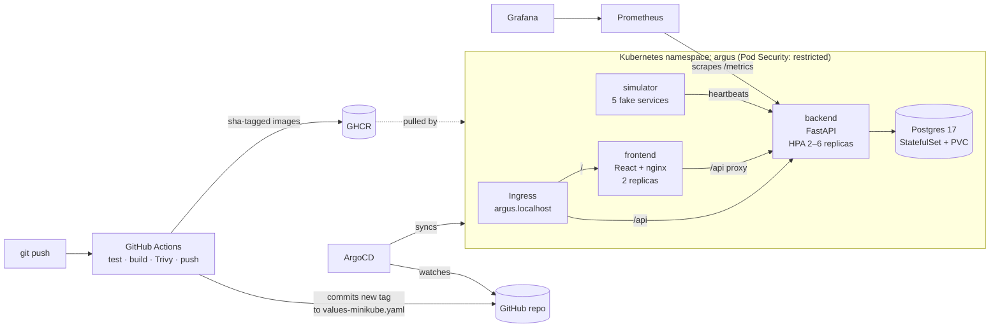
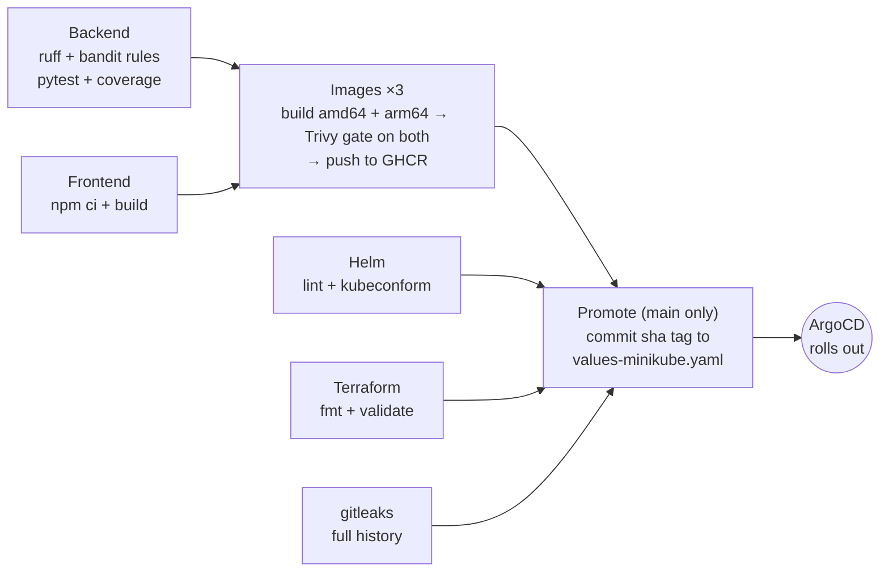

# Argus

**SLO and uptime monitoring for a fleet of services.** Services send heartbeats to Argus.
Argus works out who is up, how much of each service's error budget is left, and how fast it
is being burned. Then it tells you before the budget runs out.

[](https://github.com/arnav-yadav/argus/actions/workflows/ci-cd.yml)

> Argus is the hundred-eyed watchman of Greek myth who never slept.



**Evidence for every rubric module, with screenshots: [`docs/EVIDENCE.md`](docs/EVIDENCE.md).**

**Presentation (16 slides):** [PDF](docs/Argus-presentation.pdf) to view on GitHub, or [PowerPoint](docs/Argus-presentation.pptx) with speaker notes.

---

## What it does

1. **A service registers** with a name, a heartbeat interval (for example every 10 s) and an
   SLO target (for example 99.9%). Argus returns a one-time **ingest token**.
2. **The service sends heartbeats** with that token, each reporting `ok`, `degraded` or `fail`.
3. **Argus infers liveness from absence.** A service that misses two intervals is **down**,
   even though it never said so. A dead process cannot report its own death.
4. **Argus computes SLOs** over 1 hour, 24 hours and 7 days: uptime, error budget left, and
   burn rate. It serves them to the status board, the REST API and Prometheus.

### The SLO maths (`backend/app/slo.py`)

Time is cut into **slots**, one heartbeat interval each. A slot is *good* if at least one
`ok` or `degraded` beat landed in it.

| Quantity | Definition | Example: 99.9% SLO over 24h |
|---|---|---|
| uptime | good slots ÷ judged slots | 8 630 of 8 640 slots good → 99.884% |
| error budget | (1 − target) × window | 0.1% × 86 400 s = **86.4 s** of allowed downtime |
| budget consumed | bad seconds ÷ allowed seconds | 10 bad slots × 10 s = 100 s → 116% (breached) |
| burn rate | (1 − uptime) ÷ (1 − target) | 0.116% ÷ 0.1% = **1.16×** |

A burn rate of 1× spends exactly the budget over the window. At 14.4× a 30-day budget is
gone in about two days, and that is the threshold the fast-burn alert pages on.

Three rules make the numbers trustworthy:

- **Slots, not beat counts.** A chatty service sending five beats per interval cannot
  inflate its uptime.
- **Windows are clipped to the service's creation time.** A service registered ten minutes
  ago is judged on ten minutes, not on a day it did not exist for.
- **The in-progress slot counts only once it has a beat.** Otherwise every service would
  look slightly down between beats.

All of these functions are pure and take `now` as a parameter, so they are unit-tested
without mocking the clock.

---

## Architecture



| Component | Tech | Notes |
|---|---|---|
| Backend | FastAPI, SQLAlchemy 2, Alembic, Postgres | 13 routes, scrape-time SLO metrics |
| Frontend | React 19, Vite, nginx-unprivileged | `/api` upstream templated at start-up |
| Simulator | Python standard library only | Healthy, flaky, degraded and periodically silent services |
| Packaging | Docker multi-stage on Alpine, Helm 3 chart | Non-root, read-only root filesystem, no pip at runtime |
| Delivery | GitHub Actions → GHCR → ArgoCD | Trivy gate before push, GitOps promotion |
| Cloud | Terraform → AWS VPC + EKS 1.35 | See [`terraform/README.md`](terraform/README.md) |
| Observability | kube-prometheus-stack | Custom metrics, burn-rate alerts, provisioned dashboard |

---

## API

Interactive docs at `/docs` (Swagger UI) when the backend is running.

| Method | Route | Purpose |
|---|---|---|
| `GET` | `/health` | Liveness, does not touch the database |
| `GET` | `/ready` | Readiness, checks the database |
| `GET` | `/metrics` | Prometheus metrics |
| `POST` | `/api/services` | Register a service, returns its ingest token once |
| `GET` | `/api/services` | List services with live status (`?slug=` filter) |
| `GET` | `/api/services/{id}` | One service |
| `PUT` | `/api/services/{id}` | Change name, interval or SLO target |
| `DELETE` | `/api/services/{id}` | Remove a service and its heartbeats |
| `POST` | `/api/services/{id}/heartbeat` | Ingest a beat. Requires the `X-Argus-Token` header |
| `POST` | `/api/services/{id}/rotate-token` | Issue a new token and revoke the old one |
| `GET` | `/api/services/{id}/uptime?window=1h\|24h\|7d` | Uptime, budget, burn rate and a sparkline |
| `GET` | `/api/slo/budget?window=…` | Fleet summary: meeting, breaching, worst burn |

```bash
# Register, then beat
TOKEN=$(curl -s -X POST localhost:8000/api/services -H 'Content-Type: application/json' \
  -d '{"name":"Checkout API","heartbeat_interval_s":10,"slo_target":99.9}' | jq -r .ingest_token)
curl -X POST localhost:8000/api/services/1/heartbeat -H "X-Argus-Token: $TOKEN" \
  -H 'Content-Type: application/json' -d '{"status":"ok","latency_ms":42}'
```

---

## Running it

### Locally with Docker Compose

```bash
docker compose up --build                    # http://localhost:3000
docker compose --profile demo up --build     # plus the heartbeat simulator
```

Compose starts Postgres, then runs a one-shot `migrate` job, then the backend once
migrations succeed, then the frontend once the backend is healthy.

### Tests

```bash
cd backend
python3.13 -m venv .venv && .venv/bin/pip install -r requirements-dev.txt
.venv/bin/ruff check . && .venv/bin/pytest -v --cov=app
```

48 tests across the API, the migrations and the SLO maths. They run against an in-memory
SQLite database configured in `tests/conftest.py`, never the real one.

### On Kubernetes (minikube)

```bash
minikube start -p argus --cpus 4 --memory 6144 --addons ingress,metrics-server
./scripts/bootstrap-minikube.sh              # namespaces + generated DB password Secrets

# Monitoring first, so the chart can render its ServiceMonitor and rules
helm upgrade --install monitoring prometheus-community/kube-prometheus-stack \
  --version 92.3.1 -n monitoring --create-namespace -f monitoring/kube-prometheus-values.yaml

# Main environment (namespace argus): ArgoCD deploys the chart from main and keeps it in sync
helm upgrade --install argocd argo/argo-cd --version 10.10.3 -n argocd --create-namespace \
  -f argocd/argocd-values.yaml
kubectl apply -f argocd/application.yaml

# Staging (namespace argus-staging): installed directly with Helm, to try a build first
helm upgrade --install argus helm/argus -n argus-staging \
  -f helm/argus/values-staging.yaml --set image.tag=sha-<commit>
helm test argus -n argus-staging

# Browse http://argus.localhost:8080 and http://staging.argus.localhost:8080
kubectl -n ingress-nginx port-forward svc/ingress-nginx-controller 8080:80
```

| Environment | Namespace | Deployed by | Values | Monitoring objects |
|---|---|---|---|---|
| main | `argus` | ArgoCD, from `main` | `values-minikube.yaml` | ServiceMonitor, alerts, dashboard |
| staging | `argus-staging` | `helm upgrade --install` | `values-staging.yaml` | none, so Grafana does not count services twice |

---

## CI/CD

`.github/workflows/ci-cd.yml` runs on every push to `main`, docs-only changes included, and
on every pull request that touches code:



- **Tests gate everything.** No image is built if a test fails.
- **Images are scanned before they are pushed.** Both architectures of every image are
  built and scanned, and Trivy fails the job on any HIGH or CRITICAL finding, fixable or
  not. The full report goes to GitHub code scanning.
- **Tags are commit SHAs** (`sha-1a2b3c4` and the full SHA), never `latest`, so every
  running pod traces back to a commit.
- **Images are multi-arch.** amd64 is for EKS and the GitHub runners; arm64 is for
  Apple-silicon minikube. Each image ships with an SBOM attestation.
- **Promotion is a Git commit.** ArgoCD in the cluster pulls it. GitHub never needs
  credentials for the cluster.

---

## Security

| Control | Where |
|---|---|
| Ingest tokens are stored as SHA-256 hashes and compared in constant time | `backend/app/security.py` |
| All containers run as non-root with all capabilities dropped and a seccomp profile | Dockerfiles, Helm templates |
| Read-only root filesystem for the backend, frontend and simulator | Helm templates |
| Namespace enforces the Pod Security `restricted` profile | `k8s/namespace.yaml` |
| No package manager in the Python runtime images | `backend/Dockerfile`, `simulator/Dockerfile` |
| Alpine base images, which carry no OS packages the app does not need | all three Dockerfiles |
| Trivy gate on both architectures of every image before it can reach the registry | CI `images` job |
| gitleaks scan of the whole Git history | CI `secrets` job |
| Bandit security rules on every Python file | `backend/ruff.toml` |
| Database password created in-cluster, never committed | `scripts/bootstrap-minikube.sh` |
| AWS credentials only in `~/.aws`; `*.tfvars` and state gitignored | `.gitignore`, `terraform/` |

The Trivy gate earned its place on the first pipeline run. It blocked two images over four
HIGH CVEs in libraries that pip vendors inside itself. The fix was to remove pip from the
runtime images, which needed none of it. Later the backend moved from Debian slim to Alpine,
dropping 44 HIGH CVEs that Debian had no fix for, in packages Argus never used. That let the
gate fail on every HIGH or CRITICAL finding instead of only fixable ones. See
[`docs/EVIDENCE.md`](docs/EVIDENCE.md#m6--devsecops).

---

## Repository layout

```
backend/      FastAPI app, SLO engine, Alembic migrations, tests, Dockerfile
frontend/     React status board, nginx template, Dockerfile
simulator/    Heartbeat generator used for demos
helm/argus/   Helm chart (+ Grafana dashboard JSON, values per environment)
k8s/          Namespace with Pod Security labels
argocd/       ArgoCD Application
monitoring/   kube-prometheus-stack values and notes
terraform/    AWS VPC + EKS
scripts/      Cluster bootstrap
docs/         Evidence screenshots, indexed by rubric module
```

---

## Known limitations

- The management API (register, update, delete) is unauthenticated. It assumes it sits
  behind an internal network or SSO proxy. Only heartbeat ingest is token-protected.
- Heartbeats are kept forever. A production version would roll old beats up into hourly
  aggregates.
- The EKS cluster is created for evidence and then destroyed to stop billing. The Terraform
  can be re-applied at any time.
