# Evidence

Every screenshot below shows real output: terminal captures are the genuine output of the
command shown, and browser captures are the live pages. They are grouped by the module of
the capstone rubric they evidence.

| Module | Points | Evidence |
|---|---|---|
| [M1 Application](#m1--application) | 10 | status board in the browser |
| [M2 Testing](#m2--testing) | 10 | 48 passing tests, 98% coverage, lint clean |
| [M3 Git and GitHub](#m3--git-and-github) | 5 | commit history |
| [M4 Docker](#m4--docker) | 10 | `compose up --build`, non-root images, app on :3000 |
| [M5 CI/CD](#m5--cicd) | 15 | green pipeline, GHCR packages with SHA tags |
| [M6 DevSecOps](#m6--devsecops) | 5 | Trivy gate blocking, then passing on both architectures, with explanation |
| [M7 Terraform](#m7--terraform) | 15 | plan, apply, hardening read back from AWS, AWS Console (VPC + EKS), destroy verified empty |
| [M8 Kubernetes + Helm](#m8--kubernetes--helm) | 15 | `helm upgrade --install`, pods, services, Ingress, HPA scaling 2 → 6 |
| [M9 Observability](#m9--observability) | 10 | `/metrics`, Prometheus targets UP, Grafana dashboard |
| [M10 Docs + demo](#m10--documentation-and-live-demo) | 5 | README, commit → pipeline → GitOps rollout, [recorded walkthrough](https://youtu.be/C6kht1PKC-k) |

---

## M1 — Application

The status board, served through the Kubernetes Ingress at `http://argus.localhost:8080`.
Five simulated services report heartbeats: healthy ones sit at 100% with a 0× burn rate,
while the periodically silent *Legacy Billing* breaches its SLO and exhausts its budget.

Source: [`backend/app/`](../backend/app), [`backend/alembic/versions/`](../backend/alembic/versions),
[`frontend/`](../frontend), [`docker-compose.yml`](../docker-compose.yml).

## M2 — Testing

`ruff` (including bandit security rules) and `pytest -v` with coverage: **48 passed, 98%
coverage**. Tests use an in-memory SQLite database set up in
[`tests/conftest.py`](../backend/tests/conftest.py), never the real database. They cover
the API (service CRUD, token-protected heartbeats, uptime, fleet budget, metrics), the
migrations (upgrade and downgrade), and the SLO maths in isolation.

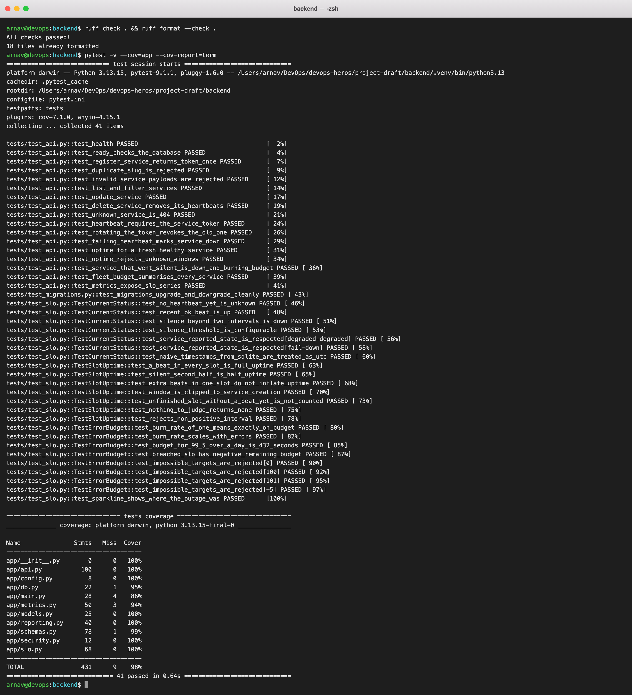

## M3 — Git and GitHub

Public repository [arnav-yadav/argus](https://github.com/arnav-yadav/argus). Each commit is
one meaningful change with a message explaining why. The `github-actions[bot]` commits are
the pipeline's GitOps promotions.

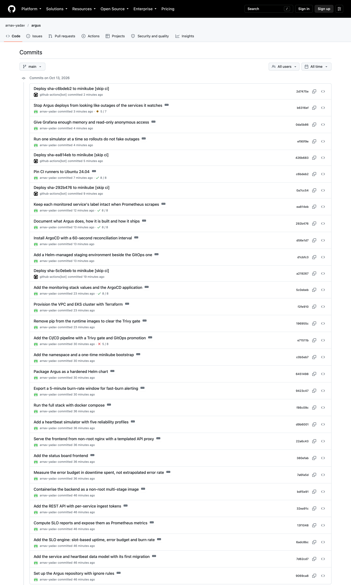
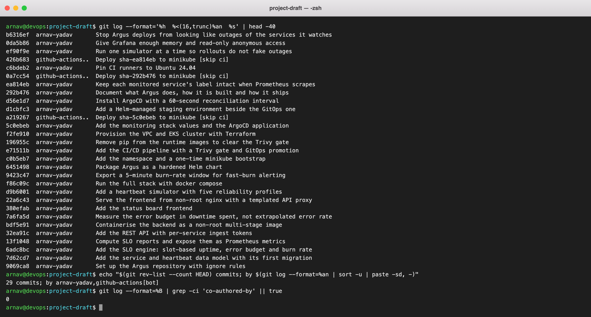

## M4 — Docker

`docker compose up --build` brings up Postgres, runs the one-shot `migrate` job, then the
backend once migrations succeed and the frontend once the backend is healthy.

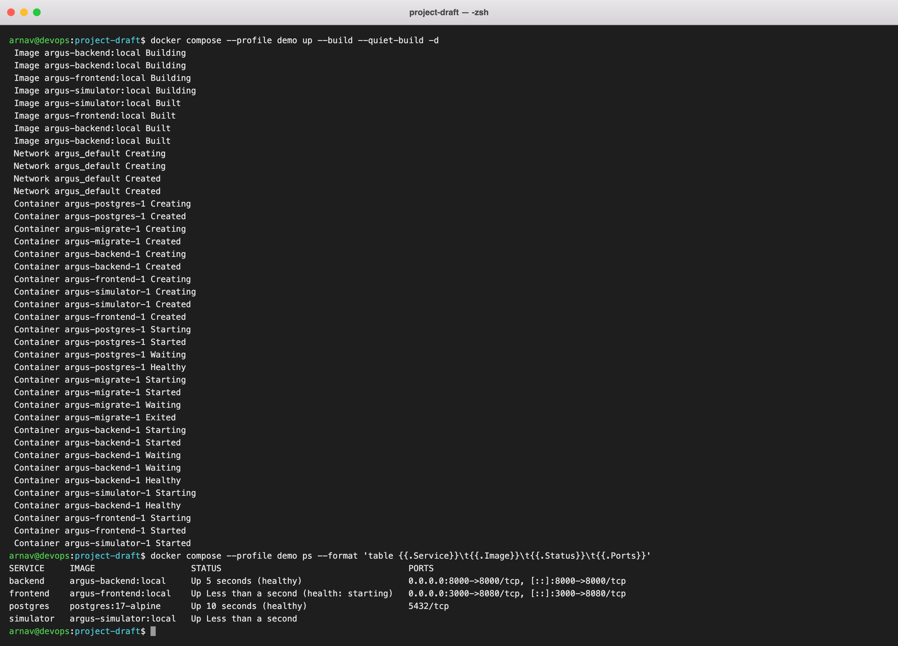

Both images run as non-root users (uid 10001 and uid 101). The frontend is a multi-stage
build: Node compiles the bundle, and nginx-unprivileged serves it.

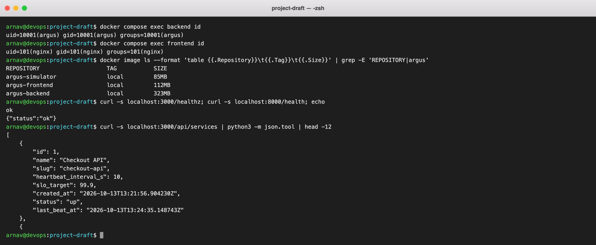

The application at `http://localhost:3000`:

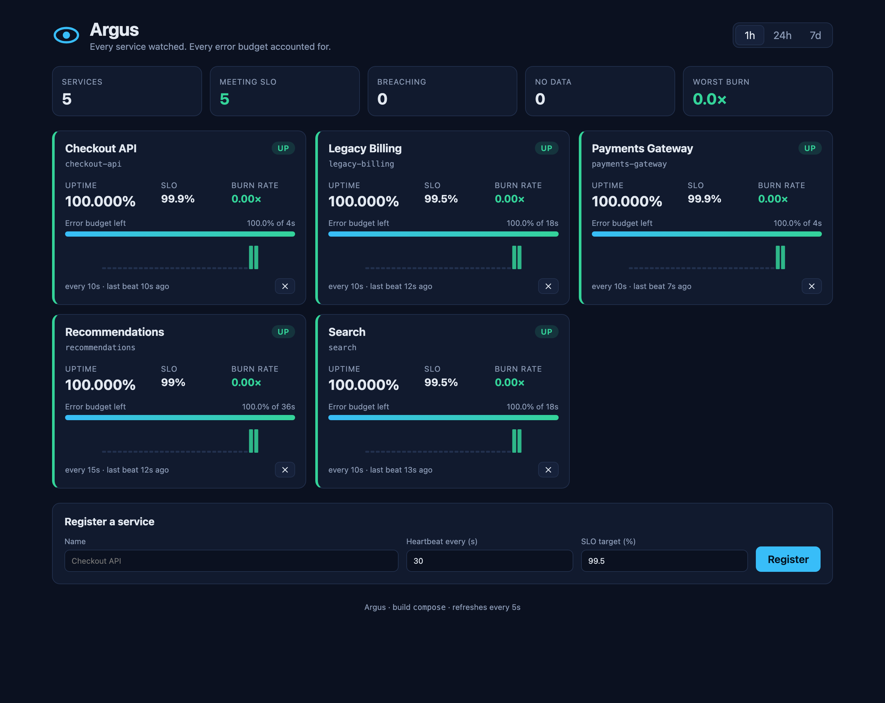

## M5 — CI/CD

[`.github/workflows/ci-cd.yml`](../.github/workflows/ci-cd.yml) runs on every push to `main`.
Tests and the frontend build gate the image builds. Three images are built, scanned and
pushed to GHCR, and the Promote job hands the new tag to ArgoCD.

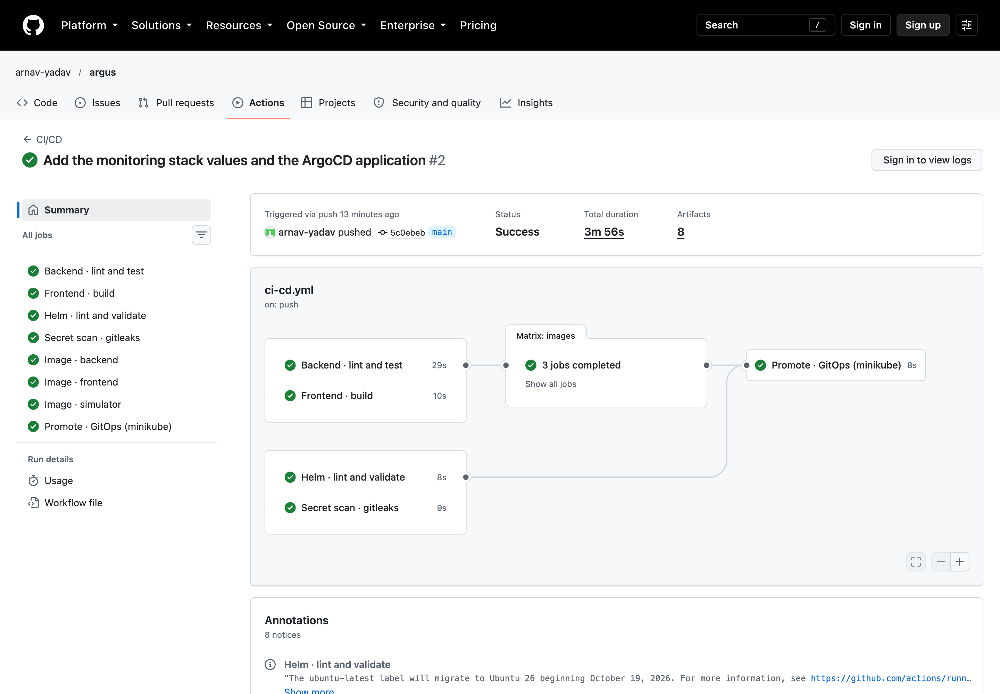

The three images in GitHub Container Registry, tagged only with commit SHAs (`sha-5c0ebeb`
and the full SHA), never `latest`, and built for both amd64 and arm64:

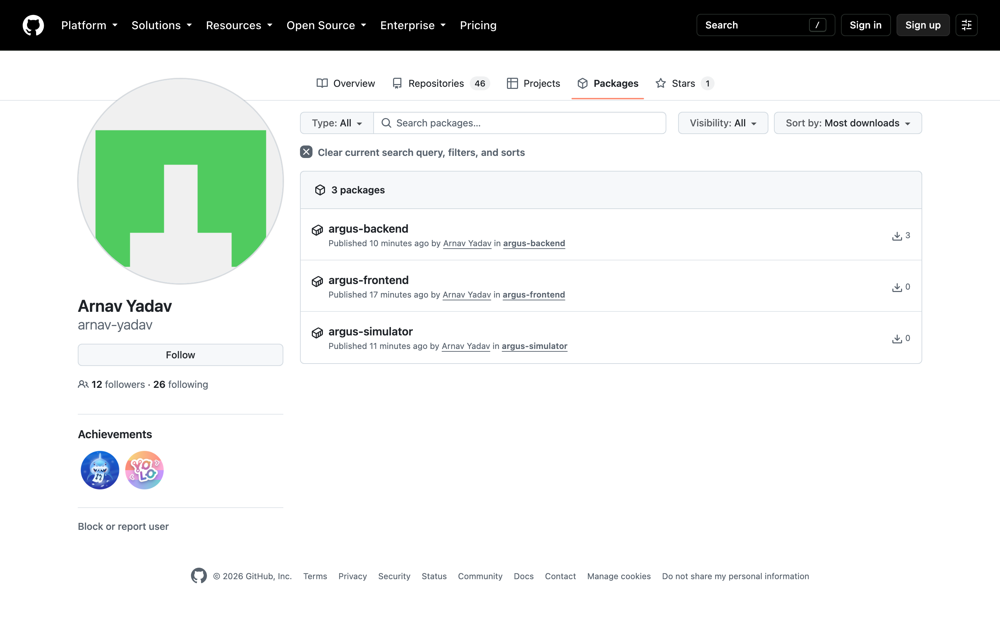
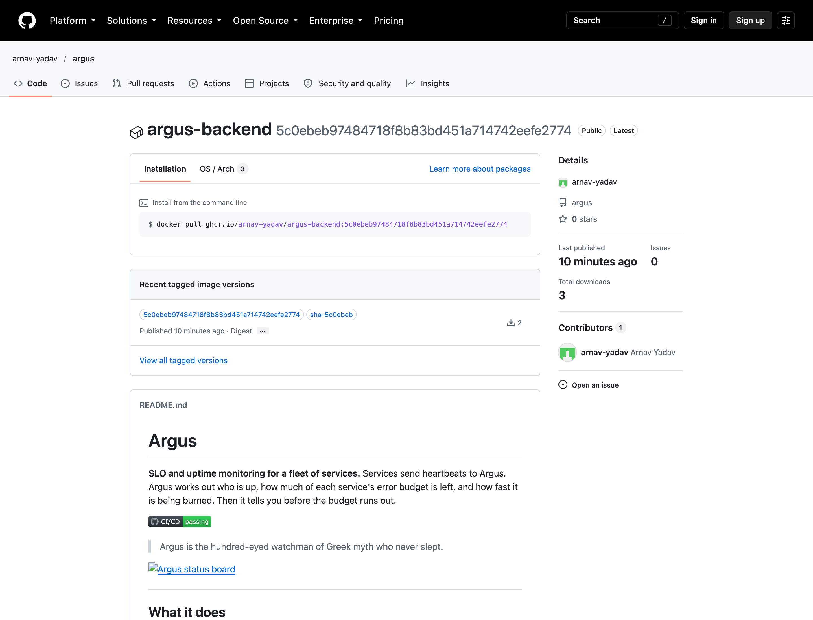

## M6 — DevSecOps

**What Trivy scans.** Each container image, in both of its architectures (amd64 and arm64),
before it is allowed into the registry. That covers the operating-system packages (Alpine
Linux in all three images) and every Python package installed in the image, including
packages vendored inside other packages. The gate fails the job on any HIGH or CRITICAL
vulnerability.

**What it found.** On the very first run, the gate blocked the backend and simulator
images. It found four HIGH vulnerabilities, all with fixes available, in code that **pip
vendors inside itself**:

- `msgpack` (GHSA-6v7p-g79w-8964, an out-of-bounds read)
- `setuptools` (CVE-2025-47273, path traversal)
- `urllib3` (CVE-2026-97687, HTTPS-proxy traffic interception)
- `urllib3` (CVE-2026-97689, denial of service through unbounded memory allocation)

The backend's Debian packages had no HIGH finding with a fix available, and all of Argus's
own dependencies were clean.

**What it means, and the fix.** pip was only there because the official Python base image
ships it, and nothing installs packages at runtime. So instead of suppressing the findings,
pip and `ensurepip` were removed from the runtime images, and the backend's virtualenv is
created without pip. On the next run, every image scanned clean and was pushed. Nothing
vulnerable ever reached GHCR, because the scan happens before the push.

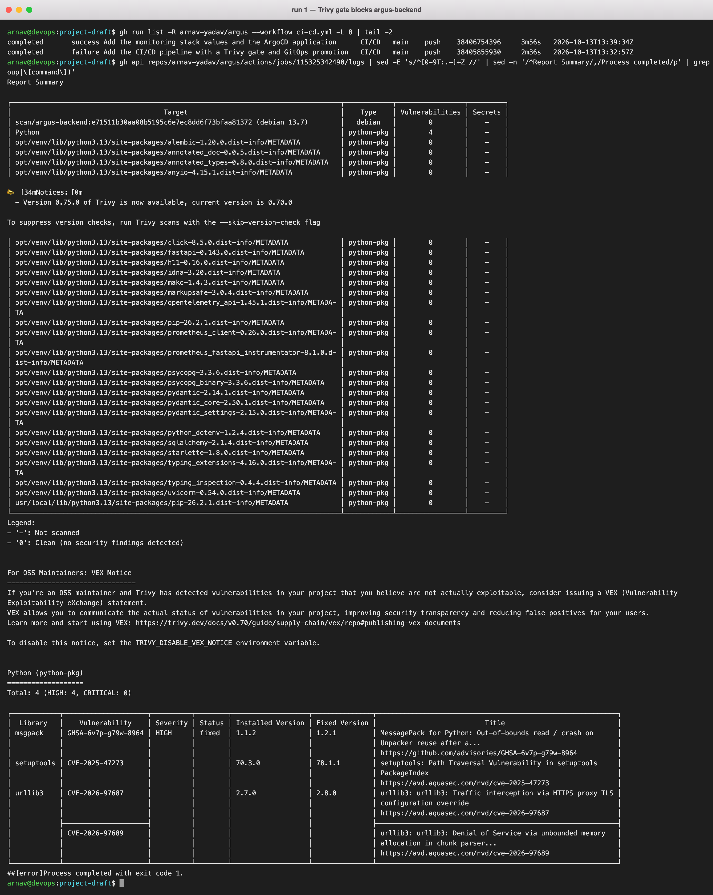
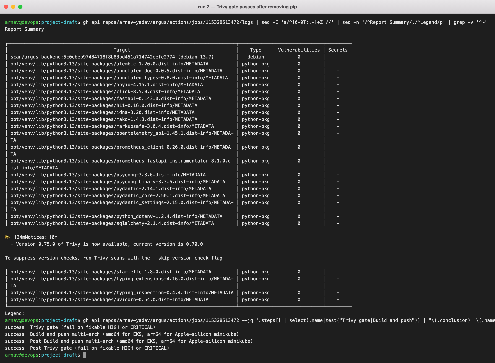

**Tightening the gate.** At first the gate skipped vulnerabilities that have no fix yet
(`ignore-unfixed`). The backend was then on Debian slim, which carried 44 HIGH CVEs that
Debian had not patched, in util-linux, perl, ncurses and systemd libraries that Argus never
runs. A later review found two gaps: those unfixed CVEs were still shipping, and only the
amd64 images were scanned, although minikube on Apple silicon runs the arm64 ones.

The backend moved to Alpine (306 MB → 178 MB), which has none of those packages. The
pipeline now builds, loads and scans both architectures before pushing. Every image then
scanned clean at every severity, so `ignore-unfixed` was removed: the gate now fails on
**any** HIGH or CRITICAL vulnerability, fixed upstream or not, in either architecture.

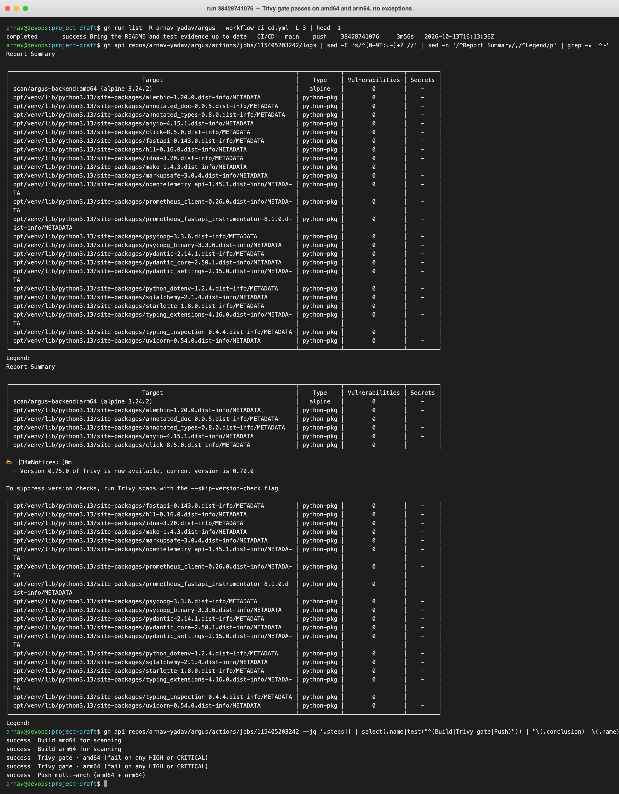

## M7 — Terraform

[`terraform/`](../terraform) provisions a VPC with two public and two private subnets, a NAT
gateway, and an EKS 1.35 cluster with a managed node group, in `ap-southeast-2`. The cluster
follows HashiCorp's Terraform security guidance and AWS's EKS guidance (see
[Security decisions](../terraform/README.md#security-decisions)): the Kubernetes API is
reachable only from the operator's address, node disks are encrypted, control-plane logs go to
CloudWatch, and unhealthy nodes are repaired automatically.

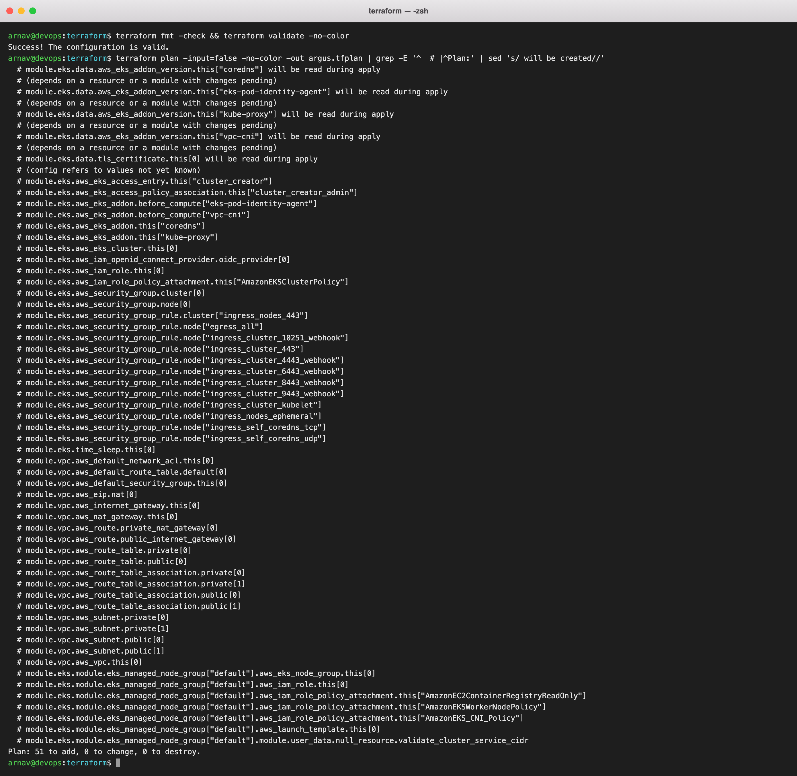

**Apply.** Applying the saved plan created all 52 resources: the VPC, subnets, NAT gateway,
the CloudWatch log group, the EKS cluster (8 minutes), its five add-ons and the node group.
The very first apply of this project had stopped on one resource: this AWS account's
organization policy denies `iam:CreateOpenIDConnectProvider`, the OIDC provider the EKS module
creates by default for IRSA. Nothing in Argus uses IRSA, and the cluster runs the EKS Pod
Identity agent instead, so the fix was `enable_irsa = false` rather than a workaround.

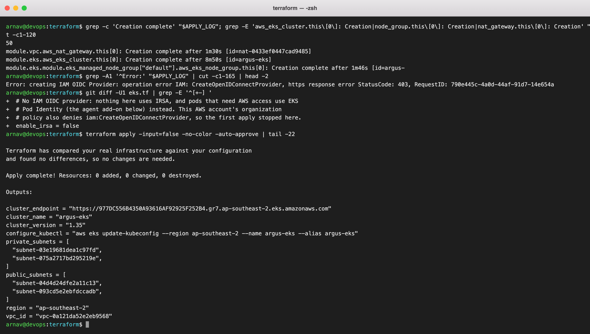

**The cluster, live.** Two `m7i-flex.large` worker nodes are Ready on Kubernetes 1.35. The
cluster is ACTIVE on the STANDARD support tier (never the 6× extended-support price), and
the VPC has two public and two private subnets across two availability zones:

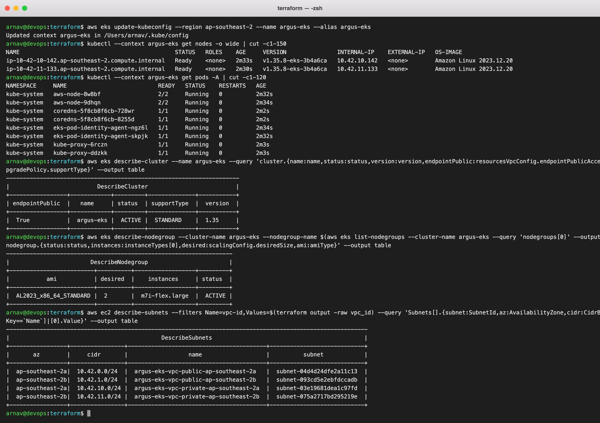

**The hardening, read back from AWS** rather than from Terraform's state:

- Authentication is through access entries only.
- API, audit and authenticator logs are on, kept for one day.
- The public endpoint accepts only the operator's `/32`, masked here, while the nodes use the
  private endpoint.
- Five add-ons are installed, including the node monitoring agent, and node auto repair is
  on.
- IMDSv2 is required with a hop limit of 1.
- Both node volumes are **encrypted** gp3. This account does not encrypt EBS by default, so
  the node disks of the earlier applies were not.

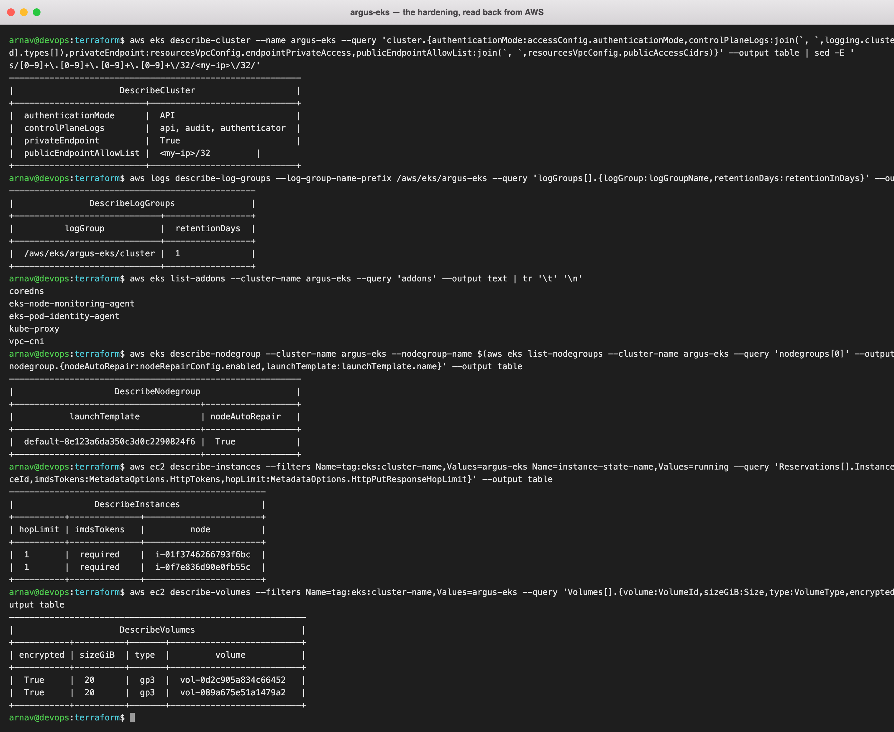

The VPC behind it: the internet gateway is attached, the NAT gateway is available, the
private subnets route through the NAT and the public subnets through the internet gateway.
At this point 28 resources carry the `Project=argus` tag.

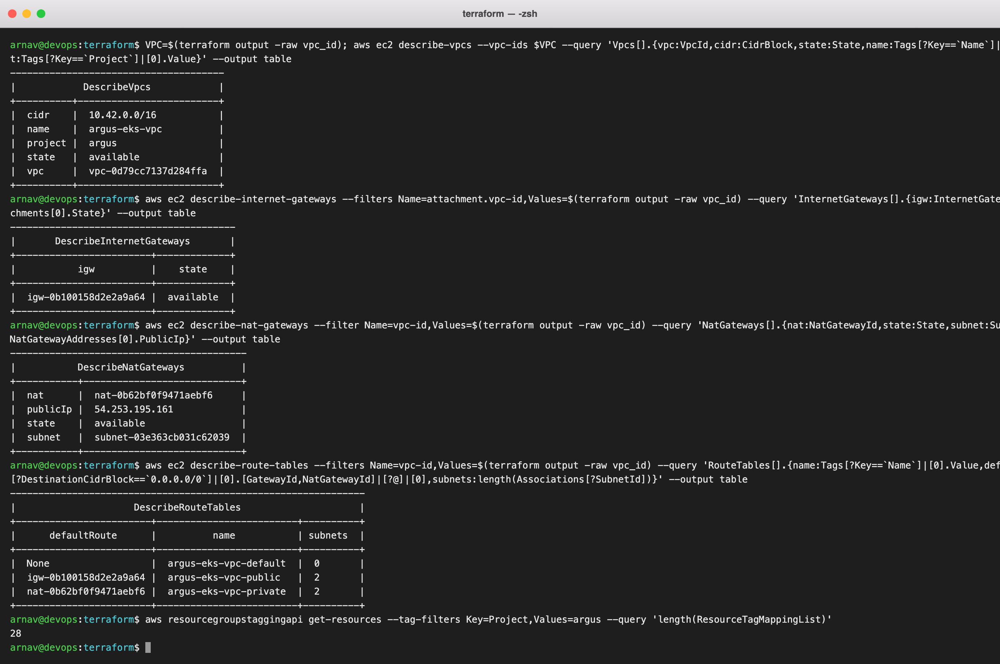

**In the AWS Console** (`ap-southeast-2`, shown in the ARNs, endpoint and AZ names). The VPC's
resource map shows the two public and two private subnets across `ap-southeast-2a` and
`ap-southeast-2b`, the three route tables, and the internet gateway. It was taken during an
earlier apply. The VPC code has not changed since, only its IDs:

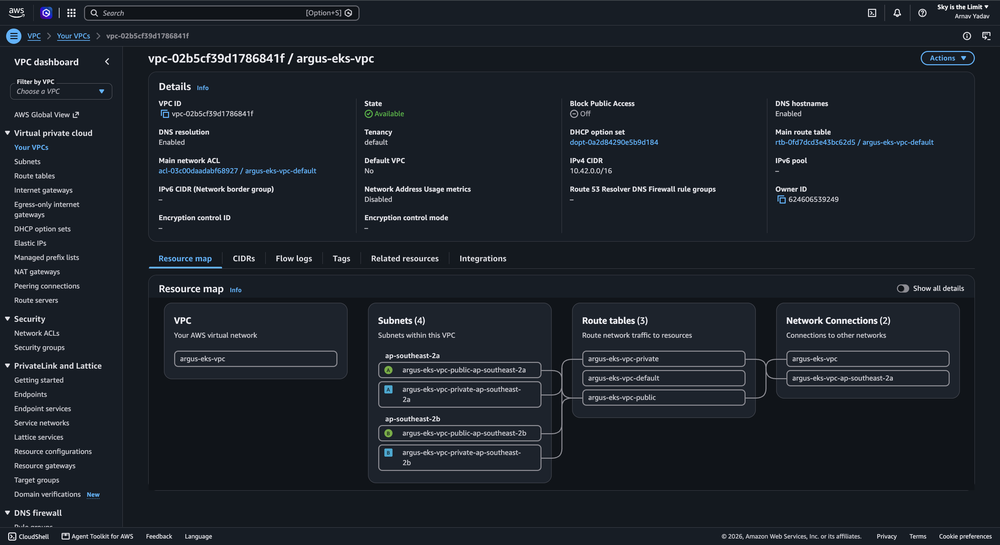

The EKS cluster:

- **Active**, Kubernetes **1.35**, on standard support until March 2027.
- One managed node group and five add-ons.
- Three IAM access entries (the Terraform identity, the node role and the EKS service role)
  and no IAM OIDC providers, since IRSA is off.

The console shows no pods or nodes because the console login is not one of those access
entries. With authentication mode *EKS API*, nothing else can reach Kubernetes. The nodes are
listed by `kubectl` above.

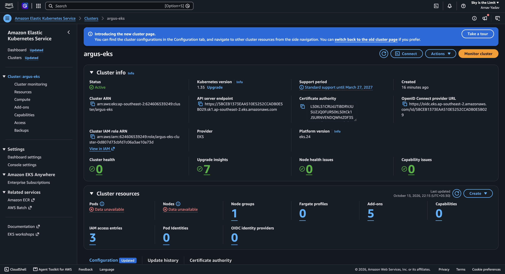

Its configuration:

- Authentication mode *EKS API* and standard support.
- Deletion protection off, so `destroy` can remove it.
- Encryption with the AWS-owned key, so there is no customer KMS key left behind.
- Networking in the Terraform-built VPC with public and private endpoint access.

The image is cropped just above the endpoint allow-list, because that shows the operator's IP
address:

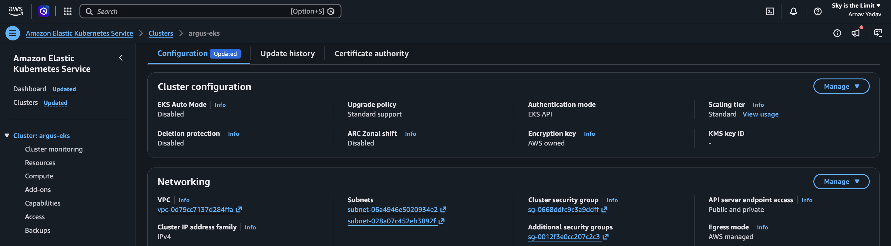

Control-plane logging has API server, audit and authenticator logs on. Every resource carries
the `Project=argus` tag used to verify the teardown:

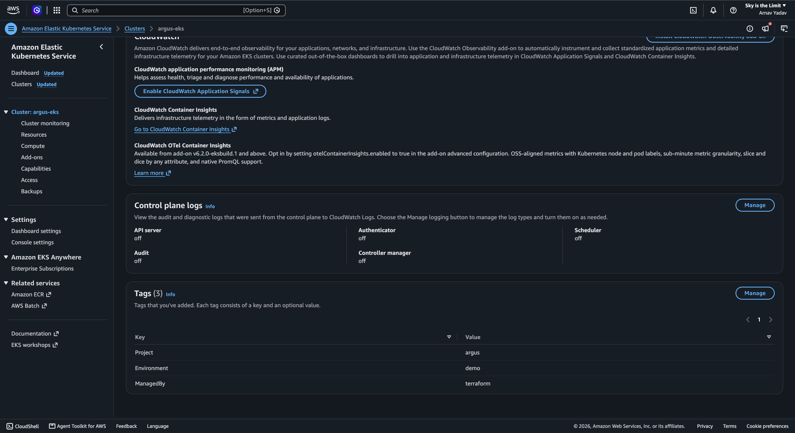

**Destroy.** `terraform destroy` removed all 52 resources in about 12 minutes. The checks
afterwards query AWS directly, not Terraform's state. None of these are left: EKS clusters,
tagged VPCs, NAT gateways, Elastic IPs, running instances, node volumes, load balancers, or
the EKS log group. Nothing is left to bill.

The cluster was created three times: for the first evidence, for the console screenshots, and
for this hardened version. It was destroyed and verified empty each time. That came to about an
hour and a half of running time, well under $1 of the account's credit.

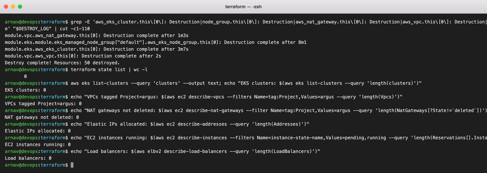

## M8 — Kubernetes + Helm

The staging environment is installed with `helm upgrade --install` and checked with
`helm test`:

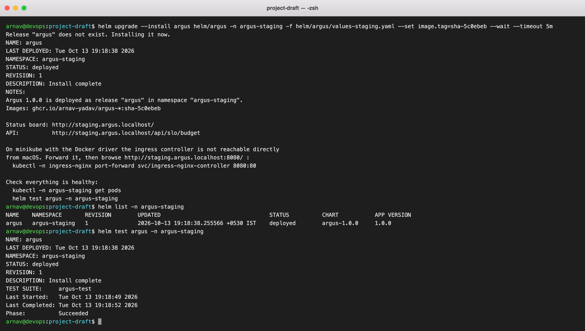

The main environment, deployed by ArgoCD from `main`: two replicas each of backend and
frontend, Postgres on a persistent volume, ClusterIP Services, an Ingress, and an HPA. The
namespace enforces the Pod Security `restricted` profile.

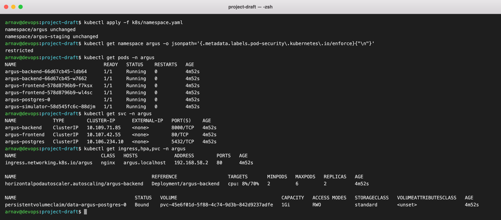

The Ingress routes `/api` to the backend and `/` to the frontend, for both environments:

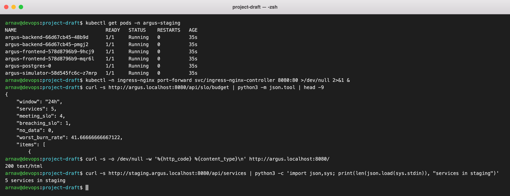

**Autoscaling.** The backend's HorizontalPodAutoscaler scales between 2 and 6 replicas on a
70% CPU target. Under load from twelve parallel clients through the Ingress, CPU climbed past
370% of the target and peaked at 383%. The HPA scaled the backend from 2 to 4 to 6 replicas within 30 seconds. No
simulated service missed a heartbeat while it scaled, and after a 5-minute cooldown it scaled
back to 2.

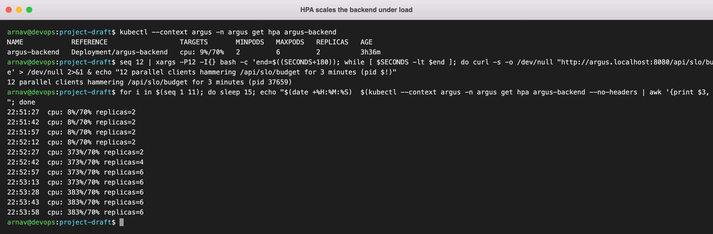

## M9 — Observability

The backend's `/metrics` endpoint: per-service SLO gauges computed at scrape time, plus
heartbeat counters and HTTP metrics.

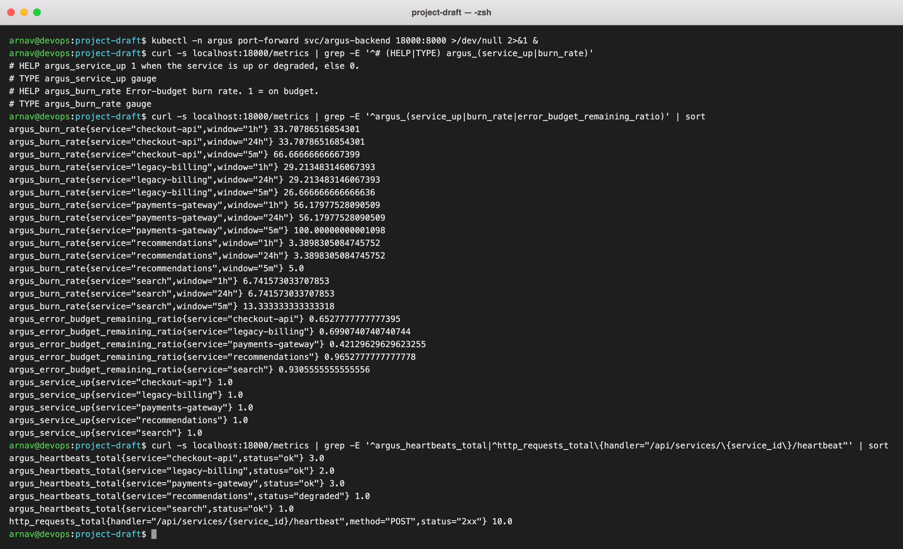

Prometheus scraping both backend replicas through the ServiceMonitor:

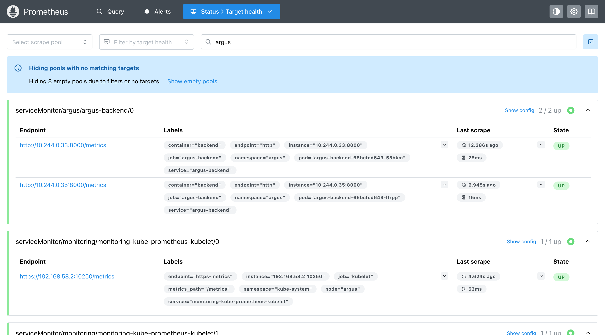

The Grafana dashboard, loaded automatically by the sidecar, with live per-service uptime,
error budgets, burn rates, heartbeat rates, request rates and latency percentiles:

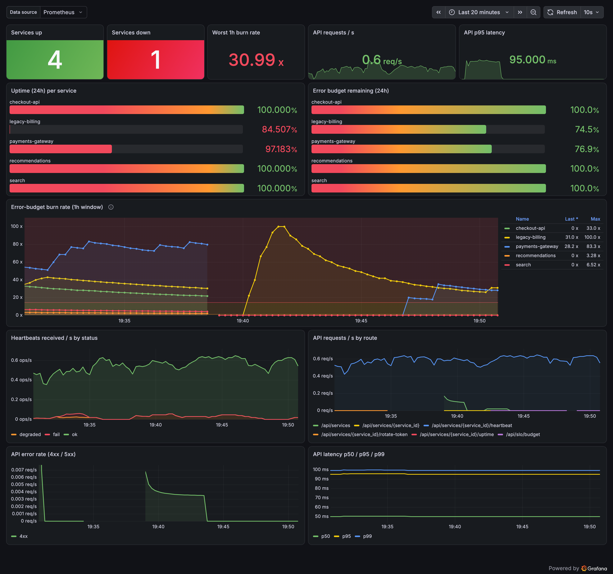

The multi-window, multi-burn-rate alerts evaluating against live data, in the SRE
workbook's three tiers:

- **Fast burn** (14.4× over 1h and 5m) is **firing** for *legacy-billing*, whose periodic
  90-second silences burn its 99.5% budget at 30×.
- **Medium burn** (6× over 6h and 30m) is firing for *legacy-billing* and for
  *payments-gateway*, whose 2% failure rate burns its 99.9% budget at about 20×.
- **Slow burn**, the ticket tier, is firing for both, and pending for a third service.

`ArgusErrorBudgetExhausted` fires for four services. An 11-minute pause of the whole minikube
stack earlier in the day used up their 24h budgets, which is what it should report.
`ArgusServiceDown` is quiet, because every service is sending heartbeats:

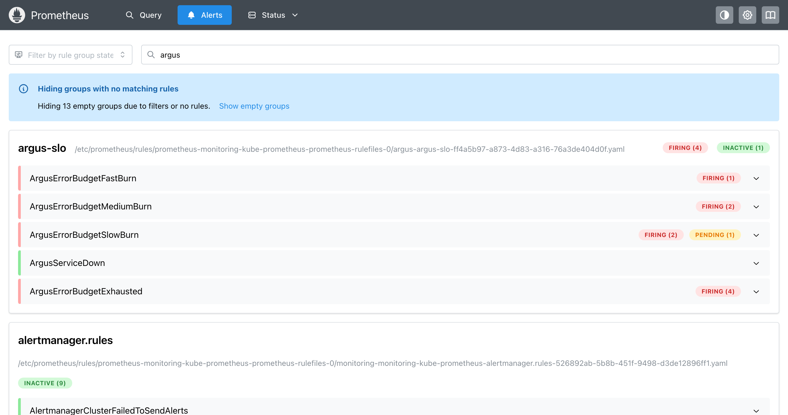

## M10 — Documentation and live demo

The [README](../README.md) explains what Argus does, the SLO maths, the architecture and how
to run it.

**Recorded walkthrough: [watch on YouTube](https://youtu.be/C6kht1PKC-k)** (3½ minutes), with
the [presentation slides](Argus-presentation.pdf). The video includes a second live run of the
demo below, recorded end to end: commit `01340e1` is pushed, the pipeline passes, the bot
commits `sha-01340e1`, ArgoCD rolls new pods, and the board's footer shows `build sha-01340e1`.

**Live demo: commit → pipeline → deployment update.** A visible change goes from a commit
to the running cluster with no `kubectl` or `helm` command run by hand.

**1. Before.** The board runs build `sha-b6316ef` with the original tagline.

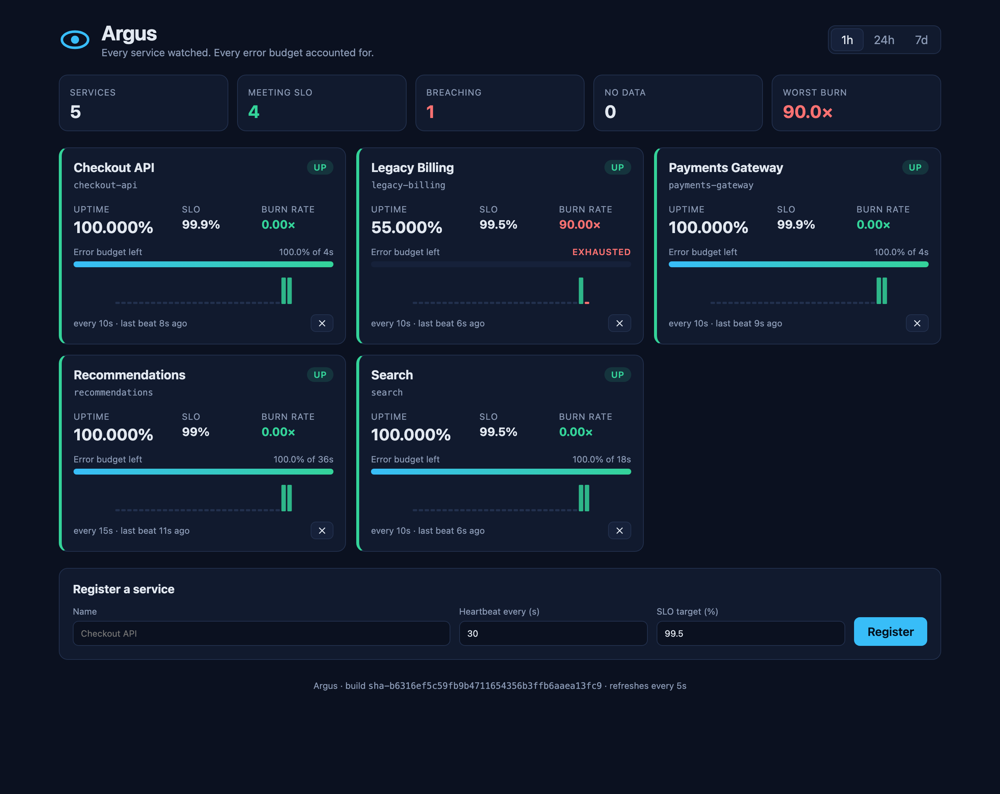

**2. Commit and push** a change to the tagline and footer.

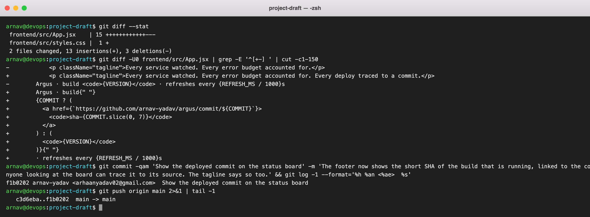

**3. The pipeline runs.** Tests, build, Trivy gate and GHCR push.

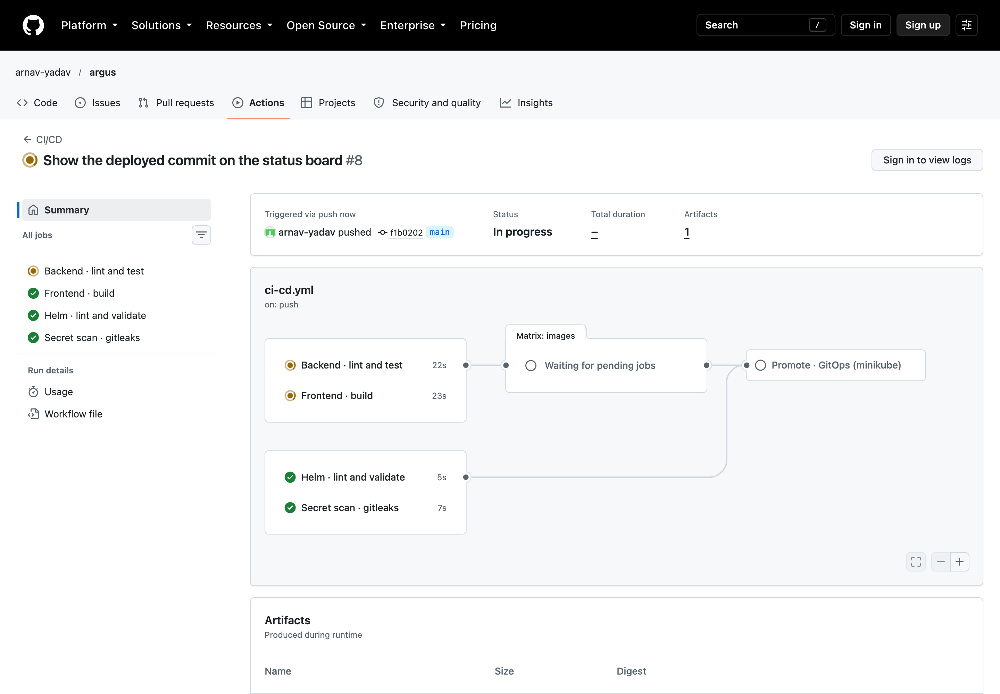
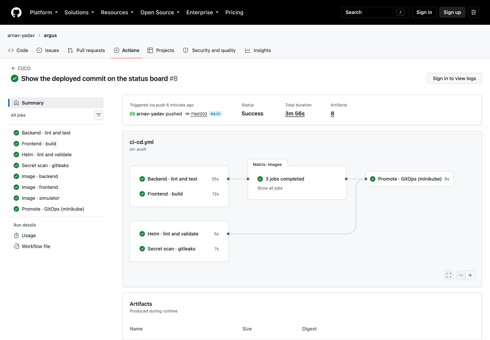

**4. The pipeline promotes the build.** The new `sha-f1b0202` images are in GHCR, and the
Promote job commits the new tag to `values-minikube.yaml` as `github-actions[bot]`.

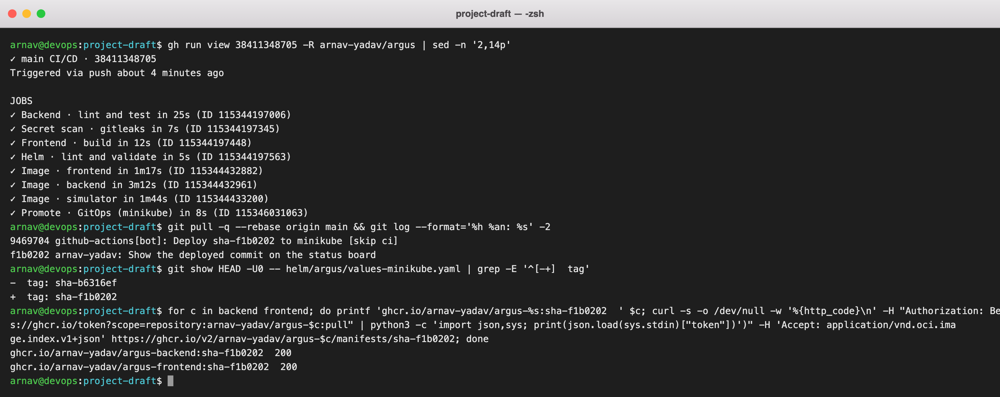

**5. ArgoCD rolls it out.** ArgoCD sees the commit and syncs it: the backend and frontend
now run `sha-f1b0202`, the new bundle is being served, and the application is Synced and
Healthy. The simulator, which stands in for the external services being monitored, was not
restarted, and the healthy services stayed at 100% uptime through the rollout.

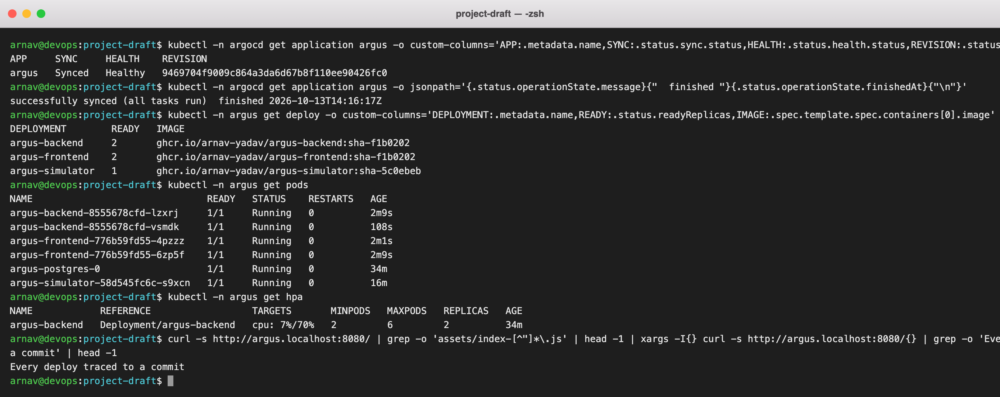

**6. After.** The board shows the new tagline, and the footer shows the running build,
`sha-f1b0202`, linked to its commit.

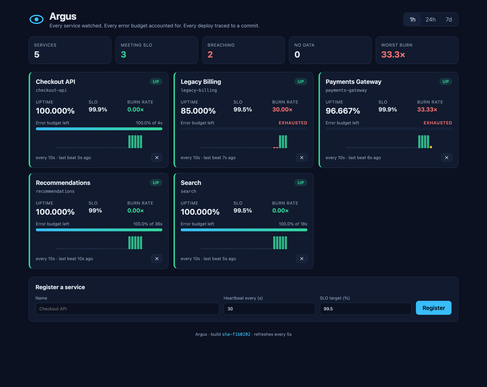
